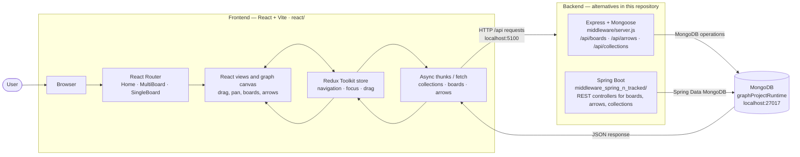

# Architektur des Graph-Projekts

## Überblick

Dieses Repository ist ein Projekt für eine visuelle, graphbasierte Wissens- und Dokumentationsoberfläche. Das Kernprinzip ist: Inhalte werden als Karten/Boards mit Verbindungen (Arrows), Positionen und Sammlungen modelliert und in einer MongoDB abgespeichert.

Die Anwendung ist bewusst in mehrere Schichten aufgeteilt:

- Frontend: React + Redux Toolkit + Vite
- Middleware/API: Node.js + Express + Mongoose
- Persistenz: MongoDB (lokal, später cloud-tauglich)
- Legacy/Experimente: Spring-Variante und Exportordner mit JSON-Dumps

## High-Level-Architektur

```text
+-----------------------------------------------------------+
| React Frontend (react/)                                   |
| - UI und Interaktion                                      |
| - Redux Store                                             |
| - Board-, Collection- und Arrow-Logik                     |
| - API-Calls an den Middleware-Server                      |
+---------------------------+-------------------------------+
                            |
                            | HTTP / JSON
                            v
+-----------------------------------------------------------+
| Node.js / Express Middleware (middleware/)                |
| - REST-Routen                                             |
| - Controllers                                             |
| - MongoDB-Modelle                                         |
| - Validierung und Datenpersistenz                         |
+---------------------------+-------------------------------+
                            |
                            | Mongoose / MongoDB driver
                            v
+-----------------------------------------------------------+
| MongoDB                                                   |
| - Boards                                                  |
| - Arrows                                                  |
| - Collections                                             |
| - gespeicherte Positionen und Strukturen                  |
+-----------------------------------------------------------+
```

## Projektstruktur

```text
.
├── README.md
├── plan.md
├── architecture.md
├── test.json
├── db-exports/                 # JSON-Exporte von DB-Inhalten
├── react/                      # Frontend-App
│   ├── src/
│   │   ├── app/
│   │   │   ├── fetch-data/     # Redux-Slices für API-Calls
│   │   │   ├── store.ts       # zentraler Redux-Store
│   │   │   └── ...
│   │   ├── pages/
│   │   │   ├── single-board/
│   │   │   ├── multi-board/
│   │   │   └── slices/
│   │   ├── App.tsx
│   │   └── main.tsx
│   ├── package.json
│   └── vite.config.ts
├── middleware/                 # Express/Mongoose API
│   ├── app/
│   │   ├── controllers/
│   │   ├── models/
│   │   ├── routes/
│   │   └── config/
│   ├── server.js               # Einstiegspunkt der API
│   └── package.json
├── middleware_spring_n_tracked/ # ältere Java/Spring-Version
├── .gitignore
├── LICENSE
└── ...
```

## Frontend (react/)

Das Frontend ist eine React-Anwendung mit Vite und Redux Toolkit.

### Hauptaufgaben

- Darstellung von Boards, Karten, Pfeilen und Sammlungen
- Interaktion mit Drag & Drop, Positionierung und Navigation
- Speicherung der UI- und Graph-Logik im Redux Store
- Laden und Persistieren von Daten über REST-Endpunkte

### Wichtige Bestandteile

- `react/src/app/store.ts`
  - zentraler Store
  - kombiniert Reducers für Board-, Navigation-, Fokus- und Drag-Logik

- `react/src/app/fetch-data/`
  - spezielle Slice-Dateien für Boards, Collections und Multi-Board-Arrows
  - kapseln die Datenabfrage und Aktualisierung aus der API

- `react/src/pages/`
  - UI-Bereiche für einzelne Boards, Multi-Board-Ansichten und globale Zustände

### Redux-Architektur

Der Store ist in mehrere Bereiche aufgeteilt:

- `singleBoard`
- `allBoards`
- `multiBoardArrow`
- `collections`
- `drag`
- `focus`
- `navigation`
- `overCard`

Damit bleibt die UI-Logik modular und die Daten werden nicht über ganz viele lokale Komponenten verteilt.

## Middleware / API (middleware/)

Der Server liegt in `middleware/server.js` und verwendet:

- Express.js als HTTP-Server
- Mongoose als ODM für MongoDB
- CORS für Frontend-Anfragen

### Startpunkt

`middleware/server.js` stellt die Verbindung zur MongoDB her und registriert die Routen aus `app/routes`.

### Route-Struktur

Die API wird über `/api` ausgeliefert. Beispiel:

- `POST /api/boards/` – neues Board anlegen
- `GET /api/boards/` – alle Boards laden
- `GET /api/boards/:id` – einzelnes Board laden
- `PUT /api/boards/:id` – Board aktualisieren
- `DELETE /api/boards/:id` – Board löschen

Zusätzlich gibt es Routen für:

- `arrows`
- `collections`

Diese Route-Definitionen befinden sich in `middleware/app/routes/board.routes.js`.

### Controller und Modelle

Die Logik ist in drei Schichten aufgeteilt:

- `routes/` – HTTP-Endpunkte
- `controllers/` – Request-/Response-Handling
- `models/` – Mongoose-Schemas und Modelle

Wichtige Modelldefinitionen:

- `board.model.js`
- `collections.model.js`
- `multiBoardArrows.model.js`

## Datenschema

Das Hauptmodell ist `Board`:

```js
{
  boardName: String,
  boardRubrics: Array,
  boardPosition: Object,
  linkList: Array,
  cardList: Array,
  arrowList: Array,
  collectionID: String,
  cardIDCounter: Number,
  arrowIDCounter: Number,
  anchorIDCounter: Number,
  timestamps: true
}
```

Das zeigt, dass das Projekt nicht nur einfache Karten speichert, sondern komplexe graphische Inhalte mit:

- Positionen
- Verbindungen zwischen Knoten
- Listen von Cards und Links
- Sammlungen / Gruppen von Boards

## Datenhaltung

### MongoDB

Das Projekt verwendet MongoDB lokal auf `mongodb://localhost:27017` mit einer Datenbank namens `graphProjectRuntime`.

Ziel ist eine flexible Speicherung, die in Zukunft auch in Cloud-Umgebungen wie MongoDB Atlas oder andere Hosting-Umgebungen migrierbar sein soll.

### DB-Exports

Im Ordner `db-exports/` liegen JSON-Exporte, die historische Daten oder Datensnapshotts enthalten. Sie sind wichtig für:

- Migration alter Daten
- Testdaten und Wiederherstellung
- Analyse und Datenvergleich

## Legacy / Historischer Kontext

Neben der aktuellen Node/React-Architektur gibt es noch:

- `middleware_spring_n_tracked/`
  - ältere Spring-/Java-Variante
  - zeigt, dass das Projekt in früheren Iterationen als Java-Backend entwickelt wurde

Diese Variante ist Teil des Projektverlaufs, aber die aktive Architektur scheint aktuell auf React + Express + MongoDB zu setzen.

## Typischer Datenfluss

1. Nutzer interagiert in der React-Oberfläche.
2. Redux-Slices senden API-Requests an `localhost:5100`.
3. Express-Middleware nimmt die Anfrage entgegen.
4. Controller verarbeitet die Daten und spricht mit MongoDB über Mongoose.
5. Ergebnisse werden zurück an das Frontend geliefert.
6. Redux aktualisiert den UI-State.

Beispiel:

```text
User action -> Redux thunk/slice -> fetch('/api/boards') -> Express route -> controller -> MongoDB -> JSON response -> Redux update -> UI render
```

## Entwicklungs- und Betriebsmodell

### Frontend starten

```bash
cd react
npm install
npm start
```

### Middleware starten

```bash
cd middleware
npm install
node server.js
```

### MongoDB starten

Die README beschreibt eine lokale MongoDB-Instanz via MongoDB Community Server und den Zugriff über `mongodb://localhost:27017`.

## Fazit

Die Architektur des Projekts ist klar in drei Ebenen gegliedert:

- Frontend für Interaktion und Darstellung
- Middleware für API und Logik
- Datenbank für Speicherung der graphbasierten Inhalte

Das Projekt ist damit grundsätzlich gut für eine dokumentarische, graphische Datenmodellierung geeignet und flexibel genug für spätere Cloud- oder Multi-Backend-Erweiterungen.

## Empfehlungen für die nächste Iteration

1. Ein einheitliches API-Konzept definieren (z. B. klarere Resource-Namen und Versionierung)
2. Validierung und Fehlerbehandlung an den Back-End-Routen verstärken
3. Data-Models auf typische Domain-Objekte sauberer aufteilen (Board, Card, Arrow, Collection)
4. Frontend- und Backend-Deployment dokumentieren
5. Tests für Redux-, API- und MongoDB-Integration ergänzen

## Systemdiagramm



Die Express- und Spring-Boot-Backends sind alternative Implementierungen im Repository, nicht zwingend gleichzeitig laufende Dienste. Beide sind für die lokale Entwicklung auf Port `5100` und dieselbe MongoDB-Datenbank konfiguriert.
